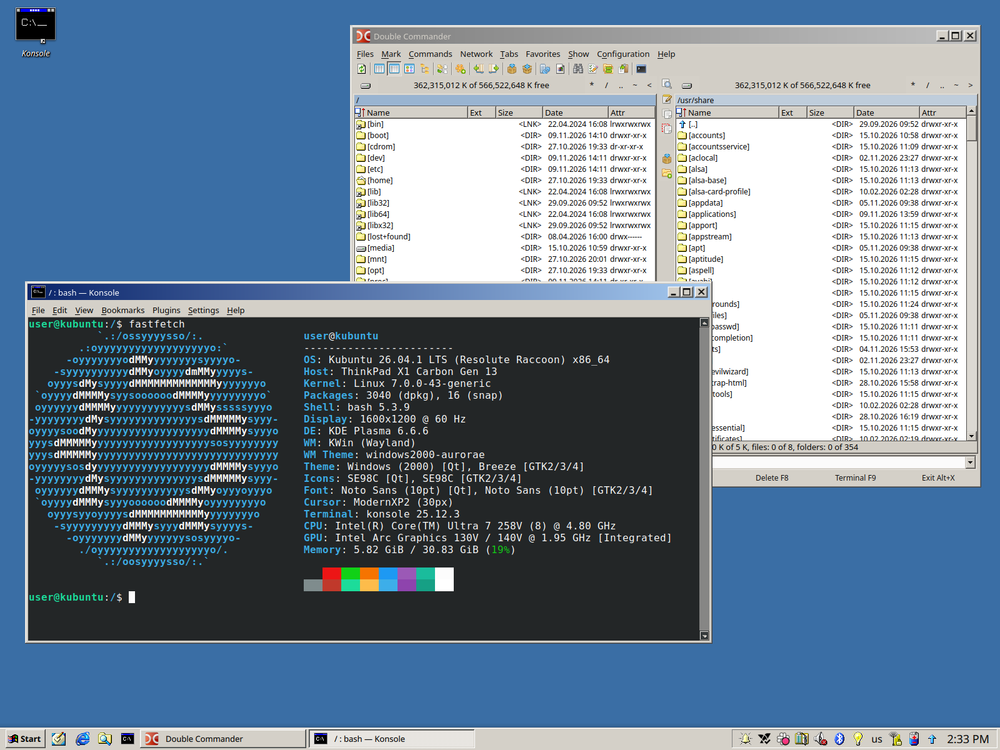
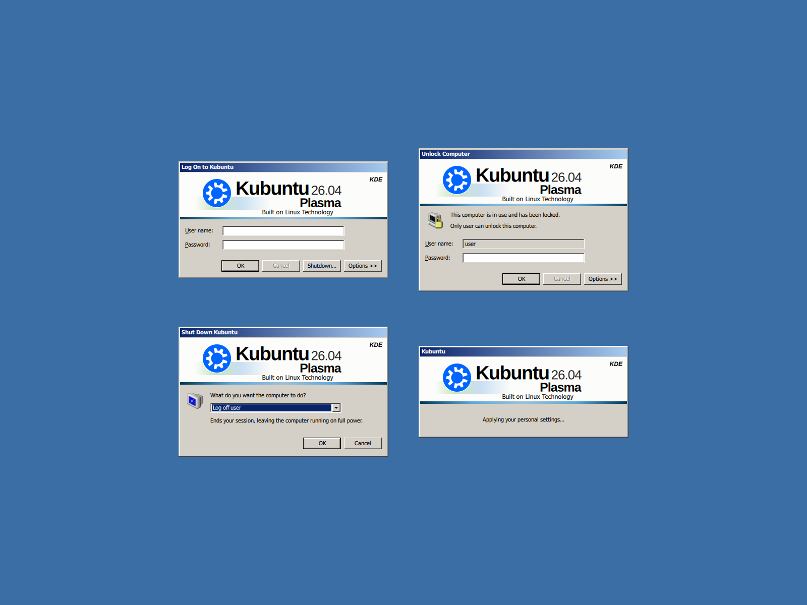
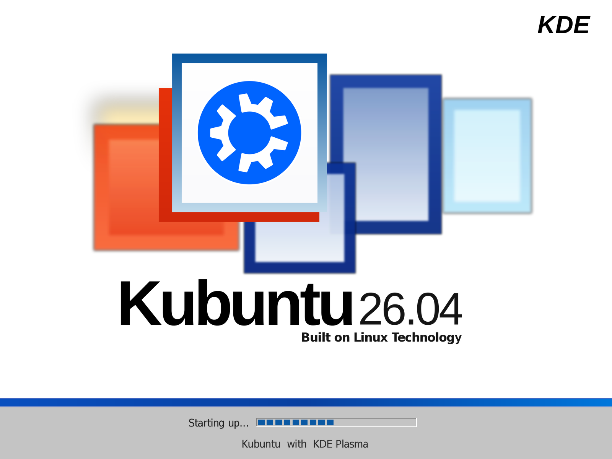
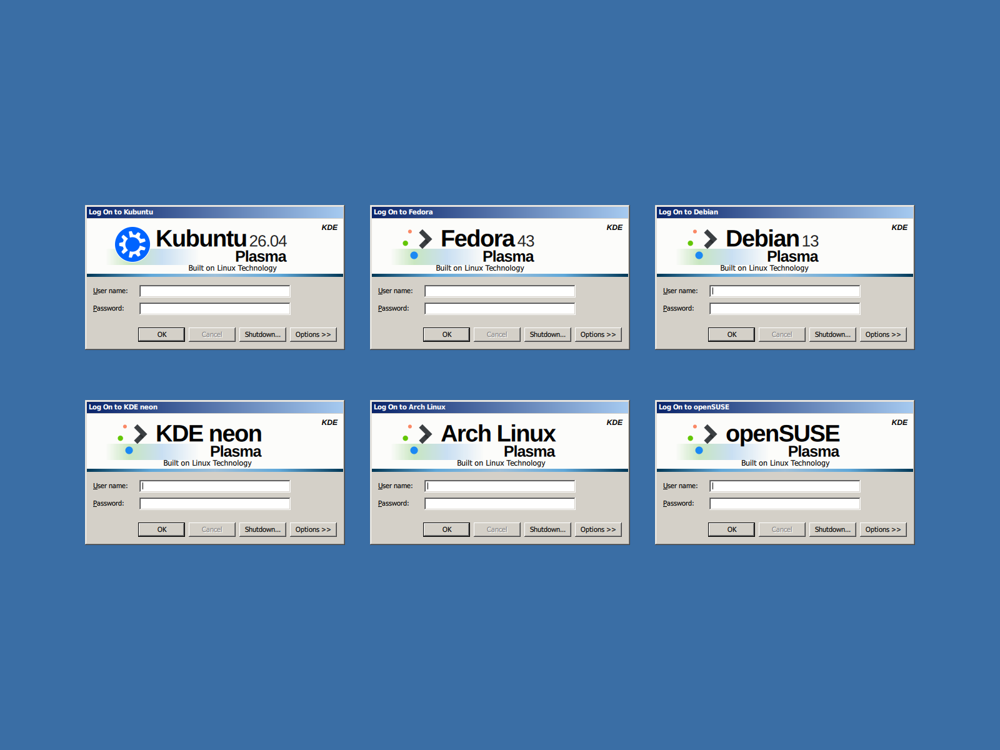
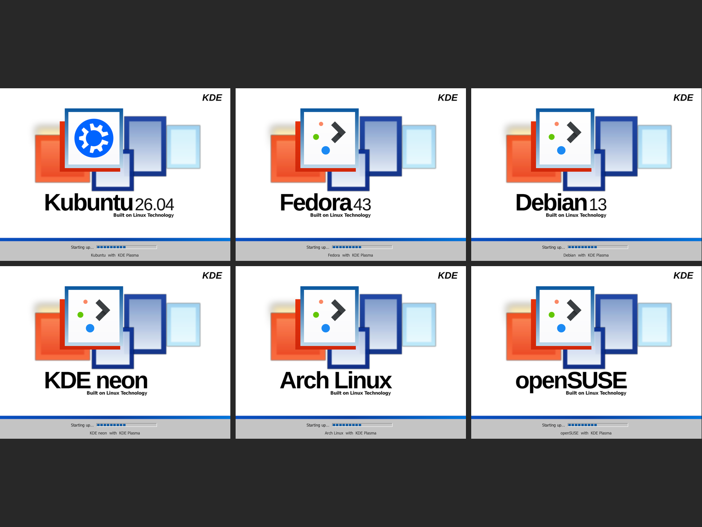

# Plasma 2000

A Windows 2000 look for KDE Plasma 6: classic taskbar with a raised Start
button, grey 3D title bars and colours, and Windows 2000 style login, boot,
lock, splash and shut down screens.

  
  
  

Desktop · login, lock, shut down and splash screens · boot screen (click for full size)

The screens show your distribution's name, release and logo (taken from your
system), for example "Kubuntu 26.04" or "Fedora 43". Rolling releases (Arch,
openSUSE Tumbleweed) show no release number.

  
  

Login and boot screens on Kubuntu, Fedora, Debian, KDE neon, Arch Linux and openSUSE.
Each shows the logo installed on your system; here only Kubuntu's was available, the others show the Plasma logo the installer falls back to.

## Requirements

- KDE Plasma 6 (tested on 6.6), Wayland or X11
- Login screen: SDDM 0.21 or newer with Qt 6
- Boot screen: Plymouth with initramfs-tools (Debian, Ubuntu, KDE neon),
  dracut (Fedora, openSUSE) or mkinitcpio (Arch)
- `python3` and `curl` (for building the Start button)

Install these two from the KDE Store first (System Settings → Colors & Themes):

| What | Where |
|---|---|
| **SE98C** icons | Icons → Get New… → search "SE98C" |
| **ModernXP** cursors | Cursors → Get New… → search "ModernXP" |

## Install

    git clone https://github.com/inf-ee/plasma-2000.git
    cd plasma-2000
    ./install.sh                    # keeps your panels and adds the Plasma 2000 widgets
    sudo ./sddm/install.sh          # login screen
    sudo ./plymouth/install.sh      # boot screen (rebuilds the initramfs, takes a minute)

Then log out and back in.

`./install.sh --layout` replaces your panels with the Windows 2000 taskbar
(Start, Minimize All, task buttons, tray box, tray, clock). It removes your
current panels and their widgets.

Each folder can also be installed on its own with its `install.sh`:

| Folder | What | Root |
|---|---|---|
| `global-theme/` | Global theme "Plasma 2000": theme defaults, splash ("Loading your personal settings..."), Shut Down dialog, taskbar layout | no |
| `colors/` | "Windows 2000" colour scheme | no |
| `aurorae/` | Title bars: grey `#d4d0c8`, blue gradient | no |
| `plasma-style/` | Panel style: React Plus without the blue strip under open panel buttons | no |
| `start-button/` | Plasma's Start menu with a raised, bold "Start" button (built from Plasma's source for your version) | no |
| `tray-frame/` | Sunken box around the system tray and clock | no |
| `lockscreen/` | "Unlock Computer" lock screen | no |
| `apply-settings.sh` | Windows-like behaviour (see below) | no |
| `sddm/` | "Log On to …" login screen | yes |
| `plymouth/` | Boot screen with progress bar and disk password dialog | yes |

### What `apply-settings.sh` changes

- Win+D minimizes all windows, so clicking a task button brings back just that
  one (Plasma's "Peek at Desktop" brings them all back). The button next to Start
  does the same.
- Task buttons show the pressed state at once (hover highlight off).
- No bouncing launch feedback (works around a KWin 6.6 bug), no wobbly windows
  or transparency.
- Clock without date, plain `#3a6ea5` desktop.

## Name and logo

The installers detect your distribution. To change what is shown, create
`~/.config/plasma2000/branding.conf`:

    name=My Distro
    version=26.04          (leave empty for none)
    logo=/path/to/logo.png
    wordmark=generic

and re-run the installers (`wordmark` picks the boot screen title from
`plymouth/wordmarks/`: kubuntu, neon, debian, fedora, arch, opensuse or generic
"KDE Plasma"). Run `sh lib/branding.sh` to see what is detected.

## Uninstall

    ./uninstall.sh                  # everything ./install.sh did
    sudo ./sddm/uninstall.sh        # login screen
    sudo ./plymouth/uninstall.sh    # boot screen

The installers remember what they replace (your colour scheme, panel style,
global theme, title bars, wallpaper, the settings listed above, the login and boot
screen) and the uninstallers put it back. Things Plasma has no "previous" for go
back to Plasma's defaults: Win+D, the clock's date and the task button highlight.
Panels removed by `./install.sh --layout` can't be brought back.

Each folder also has its own `uninstall.sh`; `./apply-settings.sh --revert` undoes
just the settings.

## Troubleshooting

- **Login screen doesn't appear:** press Ctrl+Alt+F3, log in, run
  `sudo ./sddm/uninstall.sh`, then `sudo systemctl restart sddm`.
- **Boot screen looks wrong:** the disk password prompt still works, type it and
  press Enter. To boot once without it: in GRUB press `e`, remove `splash`
  from the `linux` line, press Ctrl+X. Then `sudo ./plymouth/uninstall.sh`.
- **Lock screen fails to load:** Plasma falls back to its basic lock screen, so
  you can't be locked out. Run `lockscreen/uninstall.sh`.
- **Touch screen without a keyboard:** the lock screen's Options >> Keyboard button
  shows KWin's on-screen keyboard (Wayland, with a virtual keyboard chosen in
  System Settings → Keyboard). There is none on X11.
- **Black boot screen with disk encryption (Debian/Ubuntu):** the installer adds
  your graphics driver to `/etc/initramfs-tools/modules`; check it's there.
- **Changes not showing:** delete `~/.cache/<program>/qmlcache` or log out.
- **After a distribution upgrade** (e.g. 26.04 → 26.10): re-run `./install.sh` and the
  two sudo installers so the screens show the new release number.
- **After a Plasma upgrade:** re-run `start-button/build.sh` and
  `lockscreen/install.sh` (the lock screen installer links the rest of Plasma's
  desktop shell, so new files in an upgrade need a re-run; it warns if your
  version is untested).
- **Start button didn't build** (no network, or a newer Plasma than this version
  knows): `./install.sh` carries on with Plasma's own Start menu. See
  `start-button/README.md`.

## Licence

GPL-3.0-or-later. Parts are based on KDE Plasma, Die4Ever's Reactionary ME,
React Plus by phob1an and Wine's Tahoma font; see [CREDITS.md](CREDITS.md).
Not affiliated with Microsoft or KDE.
